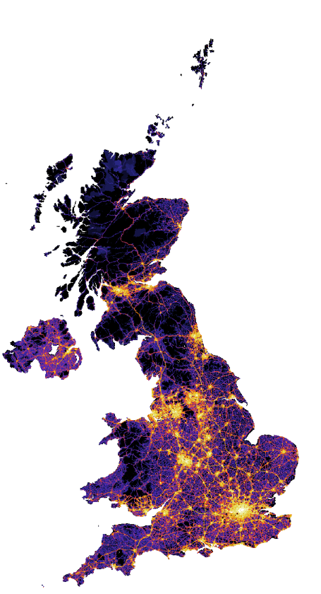

```{=html}
<div class="hero-banner column-screen">

  <!-- GEMMA logo, rebuilt so the tagline stays sharp: the wordmark is the
       original artwork (assets/gemma-logo-wordmark-navy.png, cropped from
       gemma-logo-transparent.png); the tagline is vector text set at the
       original's colour, positions and line widths (textLength). -->
  <svg class="hero-logo" viewBox="0 0 816 253" role="img"
       aria-label="GEMMA: Greenhouse Gas Emissions Measurement and Modelling Advancement">
    <image href="assets/gemma-logo-wordmark-navy.png" x="0" y="0" width="816" height="143"/>
    <g fill="#012f6b" font-family="'Helvetica Neue', Helvetica, Arial, sans-serif"
       font-size="39" text-anchor="middle" aria-hidden="true">
      <text x="408" y="193" textLength="533" lengthAdjust="spacing">Greenhouse Gas Emissions</text>
      <text x="408" y="245" textLength="816" lengthAdjust="spacing">Measurement and Modelling Advancement</text>
    </g>
  </svg>
  <p class="lead">
    Advancing greenhouse gas measurement and modelling to support
    UK climate policy and global emissions accountability.
  </p>
  <div class="hero-buttons">
    <a href="about.qmd" class="btn btn-primary btn-lg">About the project</a>
    <a href="research-highlights/index.qmd" class="btn btn-outline-primary btn-lg">Research highlights</a>
  </div>
  <!-- Decorative strip: emissions map of southern England and Wales, faded in
       from the hero background by a CSS mask. -->
  <div class="hero-map" aria-hidden="true"></div>
</div>
```

```{=html}
<!-- Feature split ─────────────────────────────────────────────────────────────
     Replace assets/uk-emissions-map.png with your image file.
     The image is displayed at up to 280 px wide at its natural proportions,
     so portrait-format maps work well here.
     Update the alt text and the figcaption to describe the specific figure.  -->
<div class="feature-split column-screen">
  <div class="feature-split-text">
    <h2>Independent, atmosphere-based estimates of UK greenhouse gas emissions</h2>
    <p>GEMMA combines measurements from atmospheric monitoring stations across the
    UK and Ireland with inverse modelling to produce independent estimates of
    greenhouse gas emissions from each part of the country — providing an evidence
    base that is separate from the statistical methods used in official greenhouse
    gas inventories.</p>
  </div>
  <div class="feature-split-image">
    
    <!-- <figcaption>Optional short caption describing the figure.</figcaption> -->
  </div>
</div>
```

```{=html}
<div class="stats-bar column-screen">
  <div class="stats-inner">
    <div class="stat-item">
      <span class="stat-number">9</span>
      <span class="stat-label">Partner organisations</span>
    </div>
    <div class="stat-item">
      <span class="stat-number">10+</span>
      <span class="stat-label">Scientists</span>
    </div>
    <div class="stat-item">
      <span class="stat-number">4</span>
      <span class="stat-label">Years of research (2023–2027)</span>
    </div>
  </div>
</div>
```

<!-- Home page sections: the classes on each `##` heading land on the wrapping
     <section>, which is styled as a full band (padding + optional tint) with the
     title INSIDE it — see `section.section-header` in custom.scss. No inner
     wrapper divs needed. -->

## About the project {.section-header .column-screen}

GEMMA (Greenhouse gas Emissions Measurement and Modelling Advancement) is a UK
research collaboration of nine organisations, led by the National Physical
Laboratory and funded by UKRI from April 2023 to March 2027. It develops ways to
check the UK's reported greenhouse gas emissions against what is measured in the
atmosphere.

GEMMA has added instruments to the UK's atmospheric monitoring network, supported
a new ten-station network that measures carbon dioxide and methane using sunlight,
and improved the inverse models that turn these measurements into emissions
estimates. The aim is a system that can report UK emissions month by month, as an
independent check on the national greenhouse gas inventory.

::: {style="text-align: center; margin-top: 1.75rem;"}
[Read more about GEMMA](about.qmd){.btn .btn-primary}
:::

## Recent research highlights {.section-header .section-tinted .column-screen}

::: {#recent-highlights}
:::

::: {style="text-align: center; margin-top: 1.75rem;"}
[View all research highlights](research-highlights/index.qmd){.btn .btn-primary}
:::

## Our partners {.section-header .column-screen}

::: {.partner-logos}
<!-- Each partner links to its homepage. Once a logo file lands in assets/logos/,
     swap the placeholder <span> for an  (see University of Bristol below).
     NB: keep each <a>...</a> on a single line — splitting it across lines makes
     Pandoc parse it as an HTML block (its own paragraph) instead of inline content,
     which breaks the flex row into a stacked column. -->
<a class="partner-logo" href="https://www.npl.co.uk" target="_blank" rel="noopener" aria-label="National Physical Laboratory"></a>
<a class="partner-logo" href="https://www.bristol.ac.uk" target="_blank" rel="noopener" aria-label="University of Bristol"></a>
<a class="partner-logo" href="https://www.metoffice.gov.uk" target="_blank" rel="noopener" aria-label="Met Office"></a>
<a class="partner-logo" href="https://www.uea.ac.uk" target="_blank" rel="noopener" aria-label="University of East Anglia"></a>
<a class="partner-logo" href="https://www.manchester.ac.uk" target="_blank" rel="noopener" aria-label="University of Manchester"></a>
<a class="partner-logo" href="https://ncas.ac.uk" target="_blank" rel="noopener" aria-label="National Centre for Atmospheric Science"></a>
<a class="partner-logo" href="https://www.nceo.ac.uk" target="_blank" rel="noopener" aria-label="National Centre for Earth Observation"></a>
<a class="partner-logo" href="https://www.ed.ac.uk" target="_blank" rel="noopener" aria-label="University of Edinburgh"></a>
<a class="partner-logo" href="https://le.ac.uk" target="_blank" rel="noopener" aria-label="University of Leicester"></a>
:::
