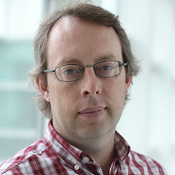
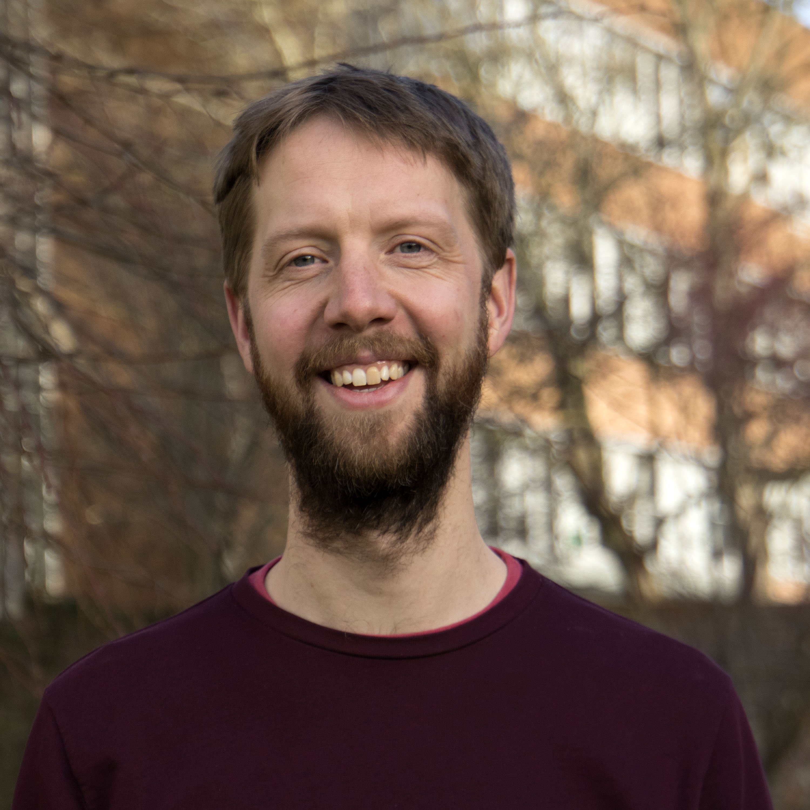
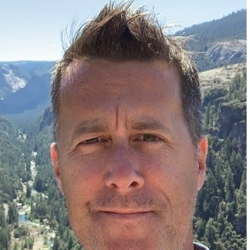
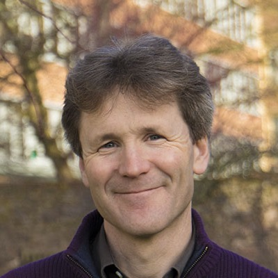
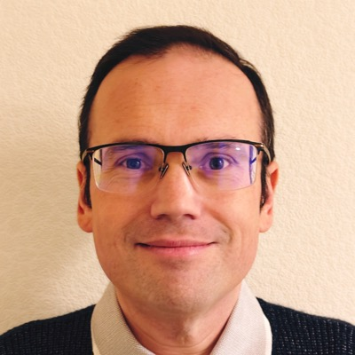
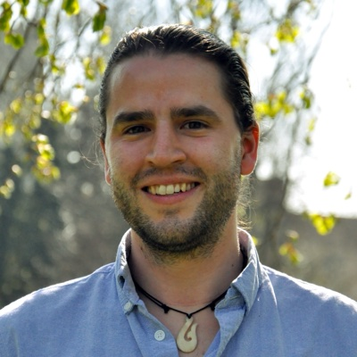
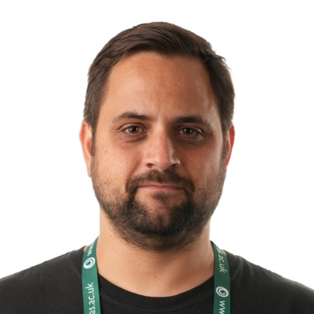

## Principal investigators

::: {.team-entry}
::: {.team-photo}
{fig-alt="Dr Tom Gardiner"}
:::
::: {.team-bio}
**Dr Tom Gardiner** · National Physical Laboratory

Lead on measurement traceability.
Research interests: atmospheric measurement, metrology, climate science.

[tom.gardiner@npl.co.uk](mailto:tom.gardiner@npl.co.uk) | [ORCID](https://orcid.org/0000-0003-4320-396X)
:::
:::

::: {.team-entry}
::: {.team-photo}
{fig-alt="Prof Matt Rigby"}
:::
::: {.team-bio}
**Prof Matt Rigby** · University of Bristol

Co-lead on inverse modelling.
Research interests: inverse modelling, atmospheric chemistry, climate science.

[matt.rigby@bristol.ac.uk](mailto:matt.rigby@bristol.ac.uk) | [ORCID](https://orcid.org/0000-0002-2020-9253)
:::
:::

::: {.team-entry}
::: {.team-photo}
<!-- Square head-and-shoulders crop of paul-palmer.png (the original is kept
     alongside). The avatar frame is square, so a portrait source is only ever
     cropped vertically by CSS — off-centre framing has to be fixed in the file. -->
{fig-alt="Prof Paul Palmer"}
:::
::: {.team-bio}
**Prof Paul Palmer** · NCEO, University of Edinburgh

Co-lead on inverse modelling and science lead on development of the GEMINI-UK
Fourier Transform Spectrometer network.
Research interests: atmospheric physics and chemistry modelling, atmospheric
measurements, metrology, climate science.

[paul.palmer@ed.ac.uk](mailto:paul.palmer@ed.ac.uk) | [ORCID](https://orcid.org/0000-0002-1487-0969)
:::
:::

::: {.team-entry}
::: {.team-photo}
{fig-alt="Prof Alistair Manning"}
:::
::: {.team-bio}
**Prof Alistair Manning** · Met Office

Co-lead on inverse modelling.
Research interests: national greenhouse gas emissions evaluation, inventory
engagement.

[alistair.manning@metoffice.gov.uk](mailto:alistair.manning@metoffice.gov.uk) | [ORCID](https://orcid.org/0000-0002-1431-7514)
:::
:::

::: {.team-entry}
::: {.team-photo}
{fig-alt="Dr Rob Parker"}
:::
::: {.team-bio}
**Dr Rob Parker** · NCEO, University of Leicester

Co-lead on integration of space-based remote sensing greenhouse gas capability.
Research interests: satellite greenhouse gas observations, methane, Earth system
model evaluation, environmental digital twins.

[rjp23@le.ac.uk](mailto:rjp23@le.ac.uk) | [ORCID](https://orcid.org/0000-0002-0801-0831)
:::
:::

::: {.team-entry}
::: {.team-photo}
{fig-alt="Dr Kieran Stanley"}
:::
::: {.team-bio}
**Dr Kieran Stanley** · University of Bristol

Co-lead on ground-based monitoring.
Research interests: atmospheric measurement, instrumentation for greenhouse gas
observations, climate science.

[k.m.stanley@bristol.ac.uk](mailto:k.m.stanley@bristol.ac.uk) | [ORCID](https://orcid.org/0000-0003-3388-0932)
:::
:::

::: {.team-entry}
::: {.team-photo}
{fig-alt="Dr Grant Forster"}
:::
::: {.team-bio}
**Dr Grant Forster** · NCAS, University of East Anglia

Atmospheric trace gas measurement scientist. Principal Investigator of the
Weybourne Atmospheric Observatory, Head of the Natural Environment Research
Council's Atmospheric Measurement and Observation Facility (AMOF), and UK Focal
Point for the Integrated Carbon Observation System (ICOS).

[grant.forster@ncas.ac.uk](mailto:grant.forster@ncas.ac.uk) | [ORCID](https://orcid.org/0000-0003-1783-9307)
:::
:::

---

## Researchers and postdoctoral fellows

::: {.team-entry}
::: {.team-bio}
**Dr Lakshmi N Bharathan** · NCEO, University of Leicester (2023–2026)

Postdoctoral researcher on integration of space-based remote sensing greenhouse
gas capability. Now a Ramanujan Fellow at the National Centre for Earth Science
Studies, India.
Research interests: satellite remote sensing of greenhouse gases, methane,
atmospheric aerosols, optimisation methods for satellite data.

[lnb5@leicester.ac.uk](mailto:lnb5@leicester.ac.uk) | [ORCID](https://orcid.org/0000-0001-5541-0961)
:::
:::

::: {.team-entry}
::: {.team-bio}
**Dr Idris Hayward** · University of Bristol

Research Associate in greenhouse gas inverse modelling, specialising in modelling of column methane using the Met Office's NAME model of how air moves
through the atmosphere.
Research interests: atmospheric transport, methane.

[ORCID](https://orcid.org/0009-0009-8743-2618)
:::
:::

::: {.team-entry}
::: {.team-bio}
**Dr Neil Humpage** · NCEO, University of Leicester

Postdoctoral researcher on GEMINI-UK, a UK network of ground-based instruments
that measure carbon dioxide and methane using sunlight.
Research interests: ground-based remote sensing of greenhouse gases, satellite
validation.

[nh58@leicester.ac.uk](mailto:nh58@leicester.ac.uk) | [ORCID](https://orcid.org/0000-0002-1109-2524)
:::
:::

::: {.team-entry}
::: {.team-bio}
**Dr Dafina Kikaj** · National Physical Laboratory

Senior Scientist in NPL's Greenhouse Gas Metrology group.
Research interests: radon as a natural tracer for interpreting greenhouse gas
measurements and testing atmospheric transport models.

[ORCID](https://orcid.org/0000-0001-7801-7396)
:::
:::

::: {.team-entry}
::: {.team-bio}
**Dr Supriya Mantri** · University of Bristol

Research Associate in the School of Chemistry specialising in inverse modelling using OpenGHG and the University of Bristol's RHIME model.
Research interests: methane, F-gases.

[ORCID](https://orcid.org/0000-0002-4058-3314)
:::
:::

::: {.team-entry}
::: {.team-bio}
**Dr Chris Rennick** · National Physical Laboratory

Senior Scientist. Runs NPL's Boreas instrument, which measures the isotopic
composition of methane at the Heathfield measurement station in East Sussex.
Research interests: methane isotope measurements, laser spectroscopy.

[ORCID](https://orcid.org/0000-0003-4993-0156)
:::
:::

::: {.team-entry}
::: {.team-bio}
**Dr Emmal Safi** · National Physical Laboratory

Scientist in NPL's Greenhouse Gas Metrology group.
Research interests: methane isotope measurements, preparing air samples for
isotope analysis.

[ORCID](https://orcid.org/0000-0002-3202-001X)
:::
:::

::: {.team-entry}
::: {.team-bio}
**Prasad Sutar** · University of Bristol

Research Software Engineer in the School of Chemistry. Lead developer of the GEMMA Console and co-developer of OpenGHG.
Research interests: open data, software engineering.

[ORCID](https://orcid.org/0009-0004-1221-6818)
:::
:::

