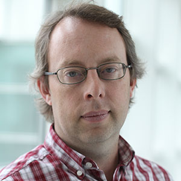
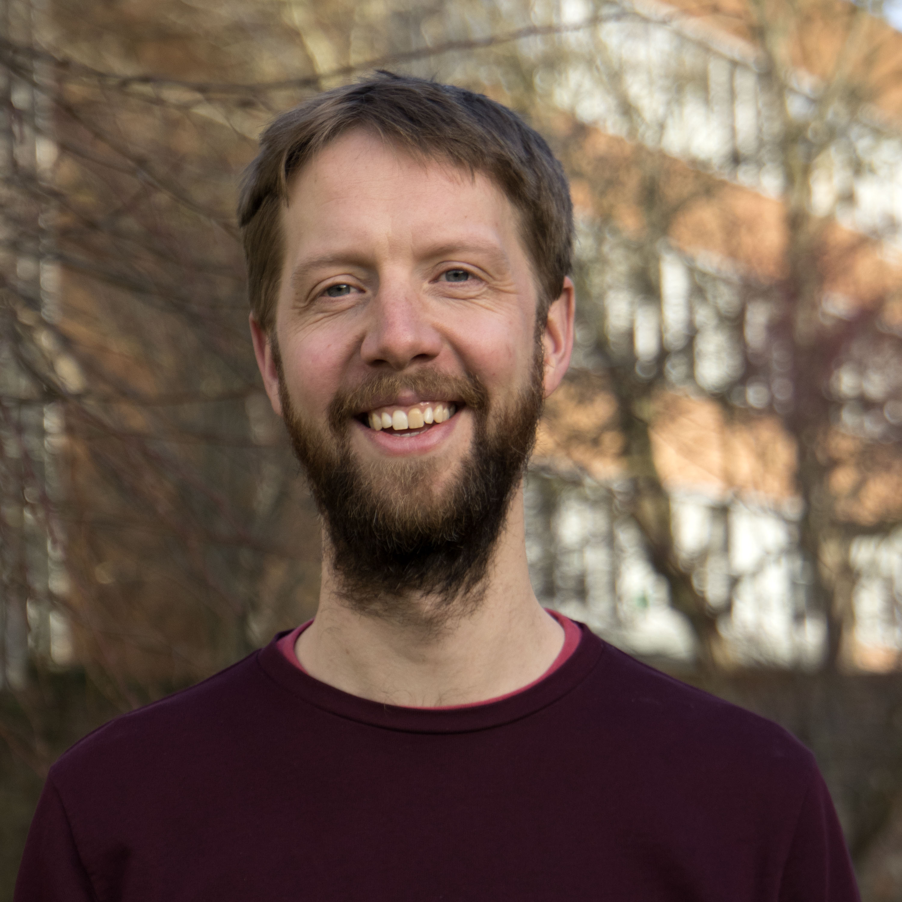
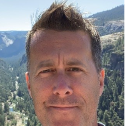
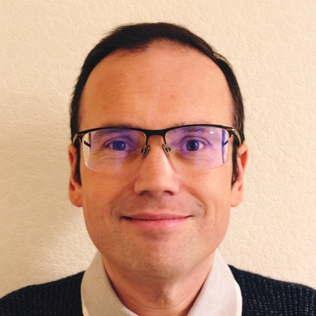
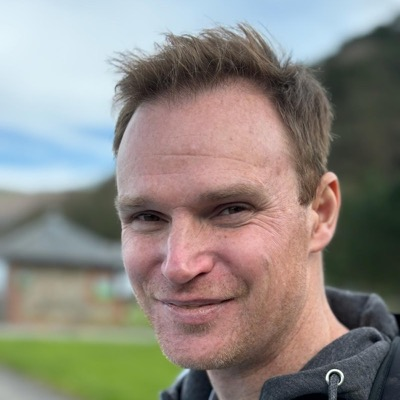

## Principal investigators

::: {.team-entry}
::: {.team-photo}
{fig-alt="Dr Tom Gardiner"}
:::
::: {.team-bio}
**Dr Tom Gardiner** · National Physical Laboratory

Lead on measurement traceability.
Research interests: atmospheric measurement, metrology, climate science.

[tg@npl.co.uk](mailto:tg@npl.co.uk) | [ORCID](https://orcid.org/0000-0000-0000-0000)
:::
:::

::: {.team-entry}
::: {.team-photo}
{fig-alt="Prof Matt Rigby"}
:::
::: {.team-bio}
**Prof Matt Rigby** · University of Bristol

Co-lead on inverse modelling.
Research interests: atmospheric measurement, metrology, climate science.

[matt.rigby@bristol.ac.uk](mailto:matt.rigby@bristol.ac.uk) | [ORCID](https://orcid.org/0000-0000-0000-0000)
:::
:::

::: {.team-entry}
::: {.team-photo}
<!-- Square head-and-shoulders crop of paul-palmer.png (the original is kept
     alongside). The avatar frame is square, so a portrait source is only ever
     cropped vertically by CSS — off-centre framing has to be fixed in the file. -->
{fig-alt="Prof Paul Palmer"}
:::
::: {.team-bio}
**Prof Paul Palmer** · NCEO, University of Edinburgh

Co-lead on inverse modelling and science lead on development of the GEMINI-UK
Fourier Transform Spectrometer network.
Research interests: atmospheric physics and chemistry modelling, atmospheric
measurements, metrology, climate science.

<!-- TODO (needs input from Matt): add Paul's email address and ORCID to match the
     other entries. -->
:::
:::

::: {.team-entry}
::: {.team-photo}
{fig-alt="Dr Rob Parker"}
:::
::: {.team-bio}
**Dr Rob Parker** · NCEO, University of Leicester

Co-lead on integration of space-based remote sensing greenhouse gas capability.
Research interests: satellite greenhouse gas observations, methane, Earth system
model evaluation, environmental digital twins.

[rjp23@le.ac.uk](mailto:rjp23@le.ac.uk) | [ORCID](https://orcid.org/0000-0002-0801-0831)
:::
:::

---

## Researchers and postdoctoral fellows

::: {.team-entry}
::: {.team-photo}
{fig-alt="Dr Neil Humpage"}
:::
::: {.team-bio}
**Dr Neil Humpage** · NCEO, University of Leicester

Postdoctoral researcher on GEMINI-UK, a UK network of ground-based instruments
that measure carbon dioxide and methane using sunlight.
Research interests: ground-based remote sensing of greenhouse gases, satellite
validation.

[nh58@leicester.ac.uk](mailto:nh58@leicester.ac.uk) | [ORCID](https://orcid.org/0000-0002-1109-2524)
:::
:::

::: {.team-entry}
::: {.team-photo}
{fig-alt="Dr Lakshmi N Bharathan"}
:::
::: {.team-bio}
**Dr Lakshmi N Bharathan** · NCEO, University of Leicester (2023–2026)

Postdoctoral researcher on integration of space-based remote sensing greenhouse
gas capability. Now a Ramanujan Fellow at the National Centre for Earth Science
Studies, India.
Research interests: satellite remote sensing of greenhouse gases, methane,
atmospheric aerosols, optimisation methods for satellite data.

[lnb5@leicester.ac.uk](mailto:lnb5@leicester.ac.uk) | [ORCID](https://orcid.org/0000-0001-5541-0961)
:::
:::

## Advisory board

*To be completed.*

